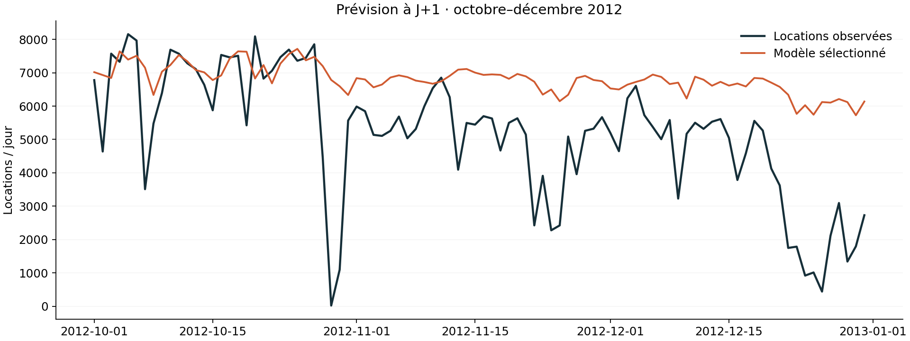

# Vélo Demain 🚲

### Prévision de la demande de vélos à J+1 · Portfolio Data Science

**Comment prévoir les locations du lendemain avec les informations réellement disponibles la veille ?**

Vélo Demain explore cette question sur le réseau Capital Bikeshare. Le projet couvre la préparation des données, la création de variables temporelles, la comparaison de modèles et l’analyse des erreurs dans une application interactive.

**Python · pandas · NumPy · scikit-learn · SQL / SQLite · Streamlit · unittest**

[Explorer le notebook](notebooks/01_exploration.ipynb) · [Consulter les résultats](reports/metrics.json) · [Voir l’application](app.py) · [Lire le pipeline](src/pipeline.py)



## Le projet en une minute

| Point clé | Ce qui est réalisé |
|---|---|
| Besoin métier | Anticiper le volume quotidien de locations pour éclairer la préparation des ressources |
| Données | 731 journées historiques ; 724 exploitables après création des retards |
| Problème ML | Régression sur série temporelle, avec un horizon d’un jour |
| Comparaison | Référence hebdomadaire, gradient boosting et forêt aléatoire |
| Évaluation | Apprentissage, validation et test séparés dans le temps |
| Restitution | Rapport HTML local, application Streamlit, prévisions exportables et requêtes SQL |
| Conclusion | Le modèle sélectionné sur validation ne dépasse pas la référence sur le test final |

Le résultat principal est une décision étayée : **dans les conditions évaluées, conserver la référence hebdomadaire plutôt que déployer le modèle sélectionné**. Le dépôt présente les scores et les limites qui conduisent à cette conclusion.

## Compétences illustrées

| Compétence | Réalisation | Où la vérifier |
|---|---|---|
| Préparation et qualité des données | Contrôles des valeurs manquantes, dates, plages de valeurs et comptages | [`validate`](src/pipeline.py) |
| Feature engineering temporel | Retards à J−1 et J−7, moyenne mobile décalée, calendrier et encodage cyclique du mois | [`make_features`](src/pipeline.py) |
| Modélisation et sélection | Comparaison de deux modèles appris à une référence saisonnière | [Pipeline](src/pipeline.py) |
| Évaluation ML | Sélection sur validation et mesure finale sur une période future distincte | [Métriques détaillées](reports/metrics.json) |
| Interprétation | Importance par permutation sur validation et exploration des journées difficiles | [Application Streamlit](app.py) |
| SQL | Agrégation mensuelle, comparaison des erreurs et identification des écarts extrêmes | [Requêtes SQL](analysis.sql) |
| Fiabilité et reproductibilité | Quatre tests d’intégrité temporelle, dépendances figées, graine aléatoire et empreinte des données | [Tests](tests/test_pipeline.py) · [Environnement](requirements-lock.txt) |

## Le besoin métier

Une équipe d’exploitation peut utiliser une estimation de la demande du lendemain pour préparer ses ressources. La cible est ici `cnt`, le **nombre total de locations par jour sur l’ensemble du réseau**.

L’étude évalue la qualité de cette estimation. Les données agrégées ne permettent pas de décider combien de vélos placer dans chaque station. Aucun gain financier ni effet sur la disponibilité des vélos n’a été mesuré.

## Les données

Source : [UCI Bike Sharing — Fanaee-T (2013)](https://doi.org/10.24432/C5W894).

- Période : du 1er janvier 2011 au 31 décembre 2012.
- Fichier utilisé : [`data/raw/day.csv`](data/raw/day.csv), soit 731 observations quotidiennes.
- Le fichier horaire est fourni dans le jeu d’origine, mais n’est pas utilisé par le pipeline.
- Après les sept jours nécessaires aux retards, 724 observations restent disponibles.

Le pipeline vérifie la continuité du calendrier : un décalage de sept lignes doit bien correspondre à sept jours. Il contrôle aussi l’identité `casual + registered = cnt`, utile pour détecter une fuite de données potentielle.

## La démarche de modélisation

### 1. Construire des variables disponibles au moment de prévoir

| Famille | Variables | Raison du choix |
|---|---|---|
| Calendrier | Mois, jour de semaine, jour férié, jour ouvré | Représenter les rythmes d’usage |
| Temps | Tendance en jours depuis le début de 2011 | Représenter l’évolution temporelle |
| Cycle annuel | Sinus et cosinus du mois | Représenter la proximité entre décembre et janvier |
| Historique récent | Locations à J−1 et J−7 | Utiliser la demande récente et hebdomadaire |
| Niveau récent | Moyenne des sept jours précédents | Résumer le niveau de demande récent |

`casual` et `registered` sont exclus des entrées : leur somme donne directement la cible. Les variables météo observées du jour à prédire sont également exclues, car elles ne seraient pas connues la veille. Les moyennes mobiles sont calculées **après décalage** de la cible.

### 2. Respecter l’ordre temporel

| Partition | Période | Observations | Usage |
|---|---|---:|---|
| Apprentissage | 8 janvier 2011 → 30 juin 2012 | 540 | Ajuster les modèles |
| Validation | 1er juillet → 30 septembre 2012 | 92 | Comparer et sélectionner un candidat |
| Test final | 1er octobre → 31 décembre 2012 | 92 | Mesurer la généralisation sur une période distincte |

Les paramètres sont fixés dans le code. Le candidat ayant la plus faible MAE sur validation est retenu ; la référence naïve peut elle aussi être sélectionnée. Si un modèle appris gagne, il est réentraîné sur apprentissage + validation avant l’évaluation finale.

**Protocole à J+1 :** chaque journée de test est prédite avec les vrais comptages disponibles jusqu’à la veille. Le modèle reste fixe durant le test. Prévoir le 2 octobre peut donc utiliser le comptage observé le 1er octobre ; cela ne correspond pas à prévoir tout le trimestre en une seule fois le 30 septembre.

### 3. Comparer à une référence explicite

La référence prédit le même nombre de locations que le même jour de la semaine précédente. Elle permet de vérifier si la complexité du modèle apporte un bénéfice mesurable.

| Candidat | MAE de validation ↓ | RMSE de validation ↓ |
|---|---:|---:|
| Référence hebdomadaire | 801,99 | 1 115,15 |
| **Gradient boosting** | **730,11** | **902,21** |
| Forêt aléatoire | 785,04 | 925,83 |

Les métriques sont exprimées en locations par jour. La **MAE** est la moyenne des écarts absolus entre prévisions et observations. La **RMSE** donne davantage de poids aux grandes erreurs. Le gradient boosting est sélectionné sur la MAE de validation.

## Résultats sur le test final

| Candidat évalué | MAE ↓ | RMSE ↓ |
|---|---:|---:|
| Gradient boosting sélectionné | 1 757,05 | 2 313,02 |
| **Référence hebdomadaire** | **1 457,59** | **2 047,17** |

Le modèle sélectionné présente une **MAE supérieure de 20,5 % à celle de la référence**. Son avantage sur validation ne se retrouve donc pas sur le dernier trimestre.

Ce constat motive une validation sur plusieurs fenêtres temporelles avant de retenir un modèle pour un usage opérationnel. Le graphique montre notamment des surestimations en fin d’année ; il ne permet pas à lui seul d’en établir la cause. Le modèle n’a pas été modifié après consultation du test pour améliorer artificiellement le résultat présenté.

Les scores exacts, les versions des bibliothèques, les partitions et l’empreinte SHA-256 du CSV sont enregistrés dans [`reports/metrics.json`](reports/metrics.json). Les prévisions individuelles sont disponibles dans [`reports/predictions.csv`](reports/predictions.csv).

## Explorer la démo

### Rapport HTML, sans serveur

Après avoir cloné ou téléchargé le dépôt, ouvrir **`reports/index.html` dans un navigateur**. Le rapport présente les scores, le graphique et un curseur pour examiner chaque journée du test. Garder `forecast.png` dans le même dossier que le HTML.

Le [fichier HTML affiché sur GitHub](reports/index.html) est du code source ; télécharger le dépôt permet de consulter le rapport rendu localement.

### Application Streamlit

L’application permet de :

- filtrer la période historique affichée ;
- comparer observations, prévisions et référence hebdomadaire ;
- consulter les scores de validation et l’importance des variables ;
- examiner les dix plus grandes erreurs sur la période choisie ;
- télécharger les prévisions de l’ensemble du test au format CSV.

L’importance par permutation est calculée sur la validation, pour le meilleur modèle appris de validation. Une valeur positive signifie que mélanger une variable augmente la MAE. Cette mesure ne démontre pas de causalité et doit être interprétée avec prudence lorsque les variables sont corrélées.

La démo explore une évaluation historique déjà calculée ; elle ne fournit pas de prévisions pour le réseau actuel.

## Démarrage rapide

Prérequis : **Python 3.12**, Git et un terminal. Depuis le dossier de ton choix :

```bash
git clone https://github.com/Ahmed-Mabrouki/bike-demand-ml.git
cd bike-demand-ml
python -m venv .venv
```

Activer l’environnement :

```powershell
# Windows PowerShell
.venv\Scripts\Activate.ps1
```

```bash
# macOS / Linux
source .venv/bin/activate
```

Installer l’environnement figé, vérifier le pipeline et lancer l’application :

```bash
python -m pip install -r requirements-lock.txt
python -m unittest discover -s tests -v
python -m src.pipeline
python -m streamlit run app.py
```

Les données et les résultats sont inclus : après installation, l’application peut être lancée directement sans réentraînement. La commande `python -m src.pipeline` permet de recalculer les résultats et de générer la base SQLite. Si `day.csv` manque, le pipeline le télécharge depuis UCI ; un accès réseau est alors nécessaire.

`requirements.txt` fixe les bibliothèques principales. `requirements-lock.txt` fixe aussi leurs dépendances transitives pour reproduire l’environnement utilisé.

## Organisation du dépôt

```text
bike-demand-ml/
├── app.py                         # Exploration interactive avec Streamlit
├── src/
│   ├── pipeline.py                # Contrôles, variables, sélection et évaluation
│   └── reporting.py               # Graphique et rapport HTML
├── data/raw/                      # Données UCI et documentation d’origine
├── notebooks/01_exploration.ipynb  # Exploration guidée, à exécuter
├── tests/test_pipeline.py         # Tests d’intégrité temporelle
├── reports/
│   ├── metrics.json               # Scores et traçabilité
│   ├── predictions.csv            # Prévisions et erreurs du test
│   ├── features.csv               # Table après création des variables
│   ├── forecast.png               # Graphique des résultats
│   └── index.html                 # Rapport consultable localement
├── analysis.sql                   # Analyses des volumes et erreurs
├── requirements-lock.txt          # Environnement figé
└── ci-template.yml                # Modèle de workflow, non activé
```

La base `reports/analytics.sqlite` est générée par le pipeline et exclue de Git. Les requêtes de [`analysis.sql`](analysis.sql) portent sur les volumes mensuels, la comparaison des MAE et les journées les plus difficiles à prévoir.

## Vérifications réalisées

Les **quatre tests automatisés** couvrent :

1. Le rejet de calendriers incomplets et de comptages invalides.
2. L’absence d’influence des cibles futures sur les variables déjà disponibles.
3. L’exactitude des retards et de la moyenne mobile.
4. L’ordre, la séparation et la couverture des partitions, ainsi que l’exclusion des colonnes révélant la cible.

Le pipeline a été exécuté pour produire les résultats inclus. L’affichage de l’application et le filtrage des dates ont également été vérifiés avec l’outil de test Streamlit. Le code SQL a été exécuté sur la base générée.

La CI GitHub Actions **n’est pas activée**. Le fichier [`ci-template.yml`](ci-template.yml) peut être déplacé vers `.github/workflows/ci.yml` avec une connexion disposant des droits nécessaires.

## Limites et prochaines expériences

| Limite actuelle | Prochaine expérience proposée |
|---|---|
| Données de 2011–2012, issues d’un seul réseau | Évaluer sur des données récentes et sur un autre réseau |
| Une seule fenêtre de validation et un trimestre de test | Ajouter des backtests à origines glissantes sur plusieurs saisons |
| Prévisions ponctuelles uniquement | Construire des intervalles de prédiction et vérifier leur couverture |
| Absence d’informations météo disponibles à l’avance | Comparer avec des prévisions météo archivées, datées au moment de leur disponibilité |
| Évaluation à J+1 uniquement | Définir un protocole à J+7 sans accès aux observations intermédiaires futures |

Ces expériences sont des pistes à réaliser. Toute évolution guidée par les résultats actuels devra être évaluée sur une nouvelle période encore inutilisée.

## Auteur et provenance

Projet de portfolio publié sur le profil [Ahmed Mabrouki](https://github.com/Ahmed-Mabrouki), dans le cadre d’une préparation aux candidatures en stage data science / machine learning.

Le code et la documentation ont été préparés avec une assistance IA. Le dépôt permet de reproduire les résultats et d’examiner les choix techniques ; les expériences proposées ci-dessus sont à distinguer des réalisations présentes.

**Données :** Fanaee-T, H. (2013). *Bike Sharing*. UCI Machine Learning Repository. [DOI : 10.24432/C5W894](https://doi.org/10.24432/C5W894). Licence [CC BY 4.0](https://creativecommons.org/licenses/by/4.0/). Les variables dérivées, les prévisions et les rapports sont des transformations réalisées pour cette étude ; le [Readme d’origine](data/raw/Readme.txt) est conservé.

**Code :** [licence MIT](LICENSE). Elle ne remplace pas la licence des données.
